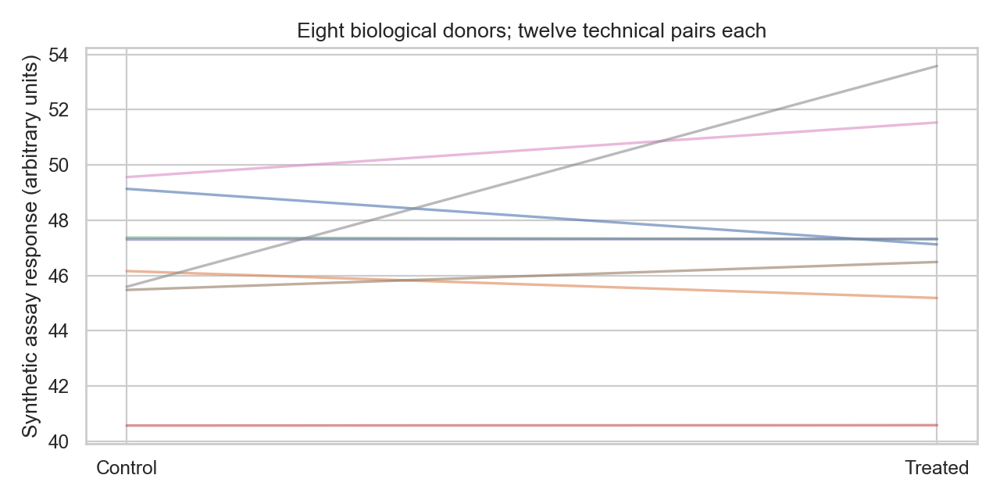

# Scientific Analysis Cases: Cell-Therapy Mathematics and Inference

Six reproducible cell-therapy analysis cases in two parts: assay mathematics (binding, counting beads, rare-cell detection) and inference pitfalls (absolute counts, technical replication, donor leakage).

**Questions:** Which physical constraints and statistical assumptions must a computational answer satisfy before it is biologically meaningful? And when can a numerically correct analysis still support the wrong biological conclusion?

**Data:** All data are synthetic and seeded. No patient, employer, proprietary assay or product data are included. These are educational reference solutions, not product specifications.




## Analysis

1. Derive one-to-one receptor/ligand mass balance and solve with a numerically stable quadratic expression. Check physical bounds and an independent bracketed root.
2. Estimate target concentration from counting beads and derive a conditional exact rate-ratio interval. Handle zero target events without claiming zero uncertainty.
3. Calculate the minimum cell count for at least one detection without background, verify the integer boundary, then add false-positive background and calibrate a blank-controlled detection threshold.
4. Calculate target-cell frequency and absolute count using the same parent population.
5. Aggregate twelve technical pairs per donor before estimating the paired effect across eight donors.
6. Compare manual t arithmetic with SciPy and enumerate sign flips under the stated null assumptions.
7. Generate a donor-fingerprint negative control with random donor labels. Compare random-row and donor-group validation.

## Results

**Assay mathematics.** At receptor = 100 nM, total ligand = 10 nM and Kd = 1 nM, bound complex is 9.89024 nM and occupancy is 9.89024%, not the 90.909% obtained by substituting total ligand for free ligand. The bead example yields 15 cells/µL with conditional 95% interval [12.2763, 18.1931]. With prevalence 0.0001 and sensitivity 0.95, the no-background 95% detection calculation requires 31,533 cells. At 30,000 cells and a per-cell blank false-positive rate of 0.0001, an any-positive rule has a 95.022% blank false-alarm probability. Requiring at least seven positive events reduces the blank rate to 3.3501%, with power 36.9569% under the specified alternative.

**Inference pitfalls.** Target frequency increases from 20% to 35%, while the estimated target count falls from 200,000 to 140,000. Treating 96 technical pairs as independent produces p = 0.00104; the donor-level exact sign-flip p is 0.52344. In the fixed null simulation, random-row balanced accuracy is 1.000 versus 0.43125 with donor holdouts.

## What the tests protect

**`tests/test_assay_math.py`.** Mass conservation at small and large scales, independent numerical roots, receptor/ligand zero boundaries, invalid/nonfinite/overflow inputs, exact hand calculations, zero-target uncertainty, undefined zero-bead denominators, interval coverage by enumerating binomial outcomes, minimal sample size and blank false-positive control.

**`tests/test_inference_pitfalls.py`.** Hand-calculated counts, zero/invalid denominators, event-count bounds, nonfinite and overflowing input, donor-pair completeness, row-order invariance, independent t arithmetic and a null-signal leakage control.

## Libraries actually used

pandas for donor/replicate tables; NumPy for seeded simulation; SciPy for paired inference; scikit-learn for grouped validation; Matplotlib and seaborn for figures.

## Interpretation limits

**Assay mathematics.** Binding assumes one-to-one equilibrium and consistent concentration units, without avidity or kinetic effects. The bead interval assumes independent Poisson sampling and known bead addition/sample volume; it excludes pipetting, mixing, recovery and viability uncertainty. Rare-cell calculations assume independent Bernoulli classifications with fixed sensitivity/background. These calculations do not establish an empirical limit of detection, a prevalence estimate or a product release criterion.

**Inference pitfalls.** The paired t interval assumes independent donors and an adequate model for donor differences. The sign-flip test assumes symmetric/exchangeable signs under the null. The deliberately unusual synthetic donor effects illustrate sensitivity to the unit of analysis, not a definitive population inference. The leakage example is one fixed negative control, not an estimate of typical inflation. Absolute counts assume representative flow sampling and an independently valid total viable-cell count.

## Run it

Python 3.13 is the tested runtime. Dependencies, including notebook execution, are pinned in `requirements.lock` (version pins, not a hash-locked supply-chain guarantee).

```bash
python3.13 -m venv .venv
source .venv/bin/activate
python -m pip install -r requirements.lock
python scripts/validate.py
```

The validation command runs pytest, regenerates results and executes every notebook cell. Outputs go to ignored `artifacts/run/`. The executed notebooks are saved separately so the source notebooks stay clean. `reports/reference/` retains checked outputs and the validation receipt from the delivered revision.

```bash
# Equivalent isolated run, without local Python setup
docker build -t biology-problems:local .
docker run --rm --cpus=1 --memory=3g biology-problems:local
```

The container runs as an unprivileged user. GitHub Actions uses the same Python validation entrypoint. Everything runs offline after dependency installation.

## Navigate

- [`assay_math.py`](assay_math.py) and [`inference_pitfalls.py`](inference_pitfalls.py), the two case sets; [`analysis.py`](analysis.py) runs both
- Notebooks: [assay mathematics](notebooks/assay_math.ipynb) ([executed](notebooks/assay_math.executed.ipynb)) and [inference pitfalls](notebooks/inference_pitfalls.ipynb) ([executed](notebooks/inference_pitfalls.executed.ipynb))
- Tests: [assay mathematics](tests/test_assay_math.py) and [inference pitfalls](tests/test_inference_pitfalls.py)
- Findings and limitations: [assay mathematics](reports/reference/assay_math/FINDINGS.md) and [inference pitfalls](reports/reference/inference_pitfalls/FINDINGS.md)
- [Machine-readable reference results](reports/reference/assay_math/summary.json), [more results](reports/reference/inference_pitfalls/summary.json) and the [validation receipt](reports/reference/validation.json)
- [Analysis plan](docs/ANALYSIS_PLAN.json), a local design record rather than an externally registered protocol

## Authorship and use

Prepared for Kalif Shear's scientific Python portfolio with AI-assisted implementation. The code, tests and retained execution results are inspectable. These are new portfolio projects; synthetic and public-data provenance is disclosed above. Code is MIT licensed; any external source data remain subject to their own terms and attribution requirements.
