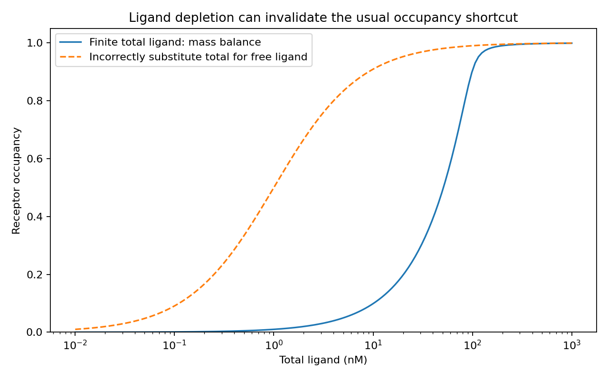

# Biology problems

Step-by-step Python reference solutions for binding, counting-bead uncertainty and rare-cell detection.

**Question:** Which physical constraints and statistical assumptions must a computational answer satisfy before it is biologically meaningful?

**Data:** Three original synthetic problems grounded in cell-therapy assay mathematics. These are educational reference solutions, not product specifications.



## Analysis

1. Derive one-to-one receptor/ligand mass balance and solve with a numerically stable quadratic expression. Check physical bounds and an independent bracketed root.
2. Estimate target concentration from counting beads and derive a conditional exact rate-ratio interval. Handle zero target events without claiming zero uncertainty.
3. Calculate the minimum cell count for at least one detection without background, verify the integer boundary, then add false-positive background and calibrate a blank-controlled detection threshold.

## Results

At receptor = 100 nM, total ligand = 10 nM and Kd = 1 nM, bound complex is 9.89024 nM and occupancy is 9.89024%, not the 90.909% obtained by substituting total ligand for free ligand. The bead example yields 15 cells/µL with conditional 95% interval [12.2763, 18.1931]. With prevalence 0.0001 and sensitivity 0.95, the no-background 95% detection calculation requires 31,533 cells. At 30,000 cells and a per-cell blank false-positive rate of 0.0001, an any-positive rule has a 95.022% blank false-alarm probability. Requiring at least seven positive events reduces the blank rate to 3.3501%, with power 36.9569% under the specified alternative.

## What the tests protect

Mass conservation at small and large scales, independent numerical roots, receptor/ligand zero boundaries, invalid/nonfinite/overflow inputs, exact hand calculations, zero-target uncertainty, undefined zero-bead denominators, interval coverage by enumerating binomial outcomes, minimal sample size and blank false-positive control.

## Libraries actually used

NumPy for numerical arrays; pandas for power tables; SciPy for numerical roots, beta quantiles and binomial probabilities; Matplotlib for binding and detection-power curves.

## Interpretation limits

Binding assumes one-to-one equilibrium and consistent concentration units, without avidity or kinetic effects. The bead interval assumes independent Poisson sampling and known bead addition/sample volume; it excludes pipetting, mixing, recovery and viability uncertainty. Rare-cell calculations assume independent Bernoulli classifications with fixed sensitivity/background. These calculations do not establish an empirical limit of detection, a prevalence estimate or a product release criterion.

## Run it

Python 3.13 is the tested runtime. Dependencies, including notebook execution, are pinned in `requirements.lock` (version pins, not a hash-locked supply-chain guarantee).

```bash
python3.13 -m venv .venv
source .venv/bin/activate
python -m pip install -r requirements.lock
python scripts/validate.py
```

The validation command runs pytest, regenerates results and executes every notebook cell. Outputs go to ignored `artifacts/run/`. The executed notebook is saved separately so the source notebook stays clean. `reports/reference/` retains checked outputs and the validation receipt from the delivered revision.

```bash
# Equivalent isolated run, without local Python setup
docker build -t biological-problem-set:local .
docker run --rm --cpus=1 --memory=3g biological-problem-set:local
```

The container runs as an unprivileged user. GitHub Actions uses the same Python validation entrypoint. Public-data downloads require network access; the other projects are offline after dependency installation.

## Navigate

- [Source notebook](notebooks/analysis.ipynb) and [executed notebook](notebooks/analysis.executed.ipynb)
- [Implementation](analysis.py)
- [Tests](tests/test_analysis.py)
- [Actual findings and limitations](reports/reference/FINDINGS.md)
- [Machine-readable reference results](reports/reference/summary.json)
- [Analysis plan](docs/ANALYSIS_PLAN.json), a local design record rather than an externally registered protocol

## Authorship and use

Prepared for Kalif Shear's scientific Python portfolio with AI-assisted implementation. The code, tests and retained execution results are inspectable. These are new portfolio projects; synthetic and public-data provenance is disclosed above. Code is MIT licensed; any external source data remain subject to their own terms and attribution requirements.
